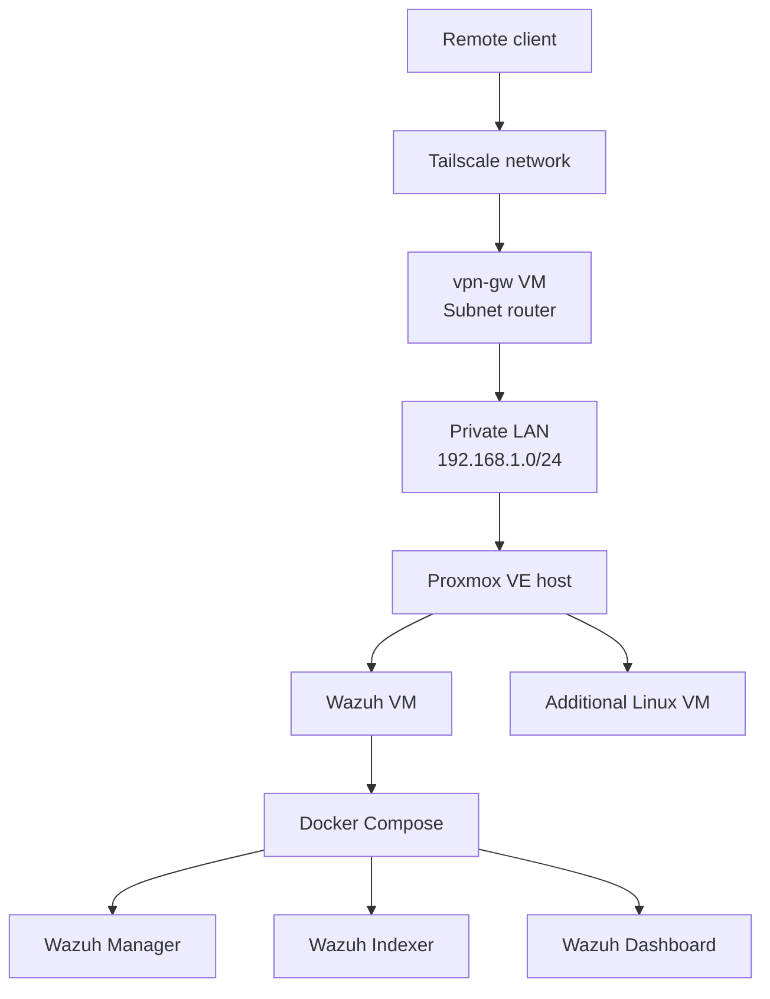

# HomeLab Architecture

## Overview

This document describes the logical architecture of the personal infrastructure and cybersecurity lab.

## Core Components

| Component | Role | Technology |
|---|---|---|
| Virtualization host | Virtual machine lifecycle management | Proxmox VE |
| Security monitoring VM | Centralized security monitoring | Wazuh |
| Container runtime | Application deployment | Docker Compose |
| Remote access gateway | Secure access to private resources | Tailscale |
| Linux services VM | Additional infrastructure workloads | Ubuntu Server |

## Network Design

The lab uses a private IPv4 network for local communication and Tailscale for remote connectivity.

Tailscale subnet routing is configured to provide access to selected private network resources through the VPN gateway.

## Wazuh Deployment

Wazuh runs as a multi-container deployment consisting of:

- Wazuh Manager
- Wazuh Indexer
- Wazuh Dashboard

Docker Compose manages the lifecycle of these services.

## Operational Considerations

- Keep service configuration separate from secrets.
- Verify port bindings after network changes.
- Monitor container health and service logs.
- Validate remote routes from an external network.
- Document recovery steps after infrastructure changes.

## Security Note

This document intentionally omits real credentials, private keys, and detailed access information. Network details should be reviewed before public release.

## Architecture Diagram

> This is a logical overview. Network paths and VM placement should be verified against the current lab configuration.
